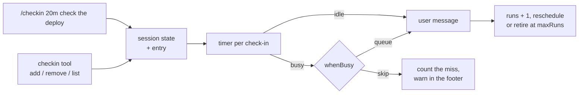

# checkin

Periodic messages to yourself inside a running session. A check-in is a user message that pi
sends on a timer, as if you had typed it: it starts a normal turn with the usual tools and
context. Both sides can create one — the model through the `checkin` tool, you through
`/checkin` — so the agent can arrange its own follow-up without being asked twice.



## Usage

```
/checkin 20m check the deploy          recurring every 20 minutes
/checkin 1h30m summarize progress      compound intervals
/checkin 30 review the open TODOs      a bare number means minutes
/checkin in 10m look at the build      one-shot
/checkin list
/checkin remove c1                     id, exact label, or unique label prefix
/checkin clear
/checkin help
```

Add `--skip` to a scheduling form to drop a firing while the agent is busy instead of queueing
it. The tool takes the same options plus `label`, `maxRuns`, and `whenBusy`:

```
checkin(action="add", prompt="Check whether the deploy finished", every="15m", maxRuns=8)
checkin(action="add", prompt="Look at the failing test", in="5m", label="test failure")
checkin(action="list")
```

A firing arrives as `[check-in <label> · every 15m · run 3/8] <prompt>`.

## Scope

- Timers live in the pi process. They stop when pi exits, and nothing here touches cron,
  launchd, or a background daemon. For work that must outlive the session, schedule
  `pi --print --session-id <id> …` from launchd instead
- Definitions are written to the session file as `checkin-state` custom entries, so `/reload`
  and `/resume` re-arm them
- Resuming measures intervals from the moment of resuming, never from a stored deadline, so a
  session reopened a week later does not fire a burst of stale check-ins
- Check-ins are per session, not per working directory: opening another session does not
  inherit them

## Limits

| Limit                | Value      | Why                                                      |
| -------------------- | ---------- | -------------------------------------------------------- |
| Concurrent check-ins | 12         | More than this turns the transcript into a metronome     |
| Recurring interval   | ≥ 30s      | Shorter cadences queue turns faster than they can finish |
| One-shot delay       | ≥ 5s       | No real use below this that is not a loop                |
| Either kind          | ≤ 1d       | A timer beyond this outlives the reason it was set       |
| Prompt               | 2000 chars | Every firing replays it into context                     |
| `maxRuns`            | 1-1000     | The recovery path for a cadence that outlived its reason |

Every firing costs a full turn. Prefer intervals of 10 minutes or more, and pair a check-in with
`maxRuns` when the condition will resolve.

## Firing while busy

`whenBusy` decides what happens when the timer fires mid-turn:

- `queue` (default) delivers the message when the current run settles, using a follow-up
- `skip` drops that firing and reports it in the footer

Either way the firing counts against `maxRuns`, so a skipped cadence still converges.

## Tests

`test/checkin/duration.test.ts` covers interval parsing and formatting;
`command.test.ts` covers the `/checkin` grammar; `schedule.test.ts` covers validation, handle
resolution, and firing rules; `runtime.test.ts` drives the real runtime against a fake clock to
check arming, queueing, retirement, restore, and dispose.
