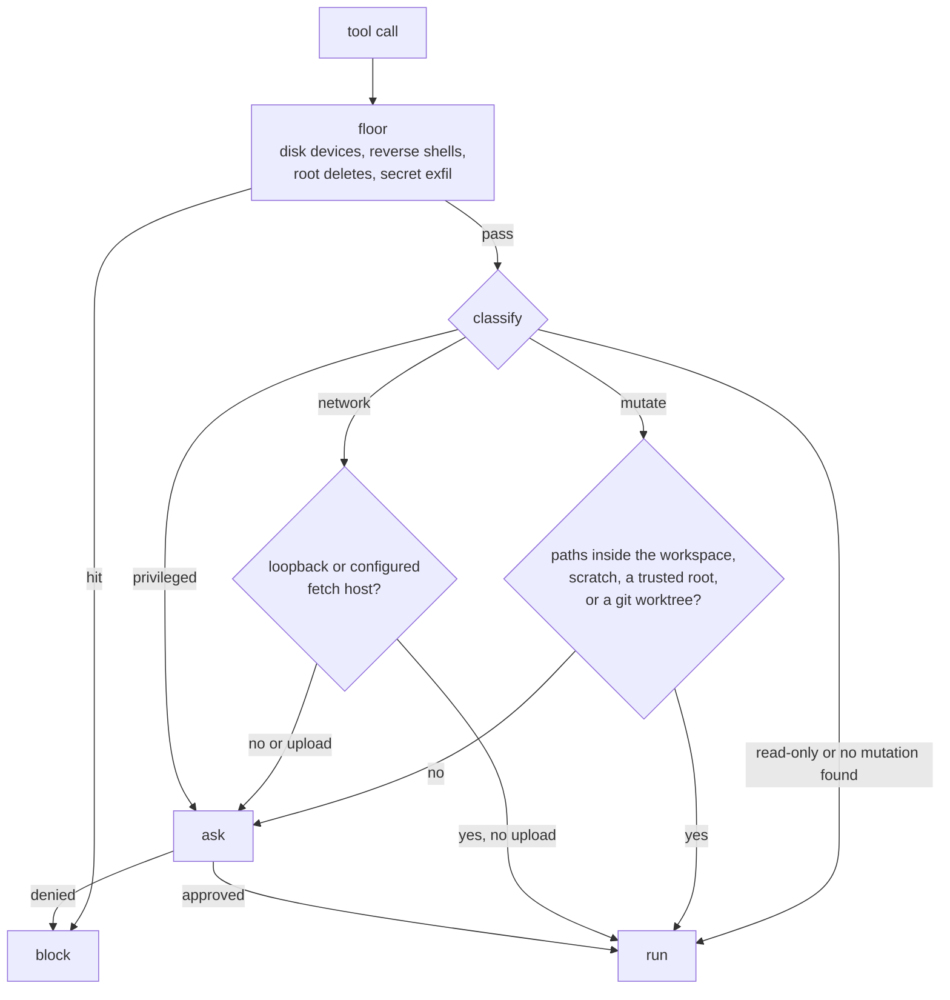

# command-guard

Guards `bash`, `write`, `edit`, and `read` with one stateless policy. There is no decision model, no approval memory, and no snapshot journal: a call is allowed, asked about, or blocked from its effects and the paths and hosts it touches. Git is the recovery mechanism for code.



## Policy

| Effect                                                                                                               | Default        |
| -------------------------------------------------------------------------------------------------------------------- | -------------- |
| Read of a non-sensitive path                                                                                         | allow          |
| Read of a credential, key, or secret                                                                                 | ask            |
| Write or edit in the workspace                                                                                       | allow          |
| Write or edit in scratch (`/tmp`, caches, `~/.Trash`)                                                                | allow          |
| Write or edit in a git worktree                                                                                      | allow          |
| Write or edit in a configured `writeRoots` entry                                                                     | allow          |
| Write or edit outside those                                                                                          | ask            |
| Delete inside the workspace, scratch, or a git worktree                                                              | allow          |
| Delete outside those                                                                                                 | ask            |
| Fetch from a configured host                                                                                         | allow          |
| Fetch from a new host                                                                                                | ask            |
| Upload data or use a non-GET request                                                                                 | ask            |
| Local and private-network access                                                                                     | allow          |
| `sudo`, `doas`, `su`                                                                                                 | ask every time |
| Package installs, services, cron, launchd, shell rc, git hooks                                                       | ask            |
| `git push` (force push always), `git clean`, `git reset --hard`, `git restore`                                       | ask            |
| Docker state changes, remote shells and transfers                                                                    | ask            |
| Process signals                                                                                                      | ask            |
| Disk devices, reverse shells, `rm -rf /` or `~`, remote scripts piped to a shell, sensitive data sent to the network | block          |
| command-guard's source, its config, and `~/.pi/agent/auth.json`                                                      | block          |

The workspace is the git root containing the session's working directory, or the working directory when it is not in a repository. A session started in the home directory or at `/` does not make that whole tree writable; writes there ask unless they land in scratch, a configured root, or a git worktree. Any path inside any git worktree is treated as recoverable, which covers sibling checkouts and `~/.worktrees`.

## Config

One file, global only. A project file is not read, so a repository cannot widen its own access.

`~/.pi/agent/command-guard.json`:

```jsonc
{
	"writeRoots": ["~/.agents"], // extra writable roots; home and / are refused
	"fetchHosts": ["api.example.com"], // extends the default registry/GitHub list
	"allowGitPush": false, // ordinary pushes; force pushes still ask
	"allowPackageInstall": false, // npm/pip/brew/cargo installs
	"allowRemoteShell": false, // ssh, scp, sftp, remote rsync
	"allowReadSecrets": false // read tool may open secrets without asking
}
```

Unknown fields and invalid values are reported when the policy is built, never silently ignored. The file is optional; with no config the defaults in the table apply. Reload with `/reload` after editing.

Common additions:

- `"writeRoots": ["~/.agents"]` if you routinely ask the agent to create or edit skills
- `"fetchHosts": ["openrouter.ai"]` is already a default; add any private API host you use
- `"allowGitPush": true` if you want the agent to push without a prompt

## Commands

`/permissions [default|yolo]` switches enforcement for the session. Yolo skips the entire guard, including the floor and self-protection; it is recorded in the session and only restored on `/reload`. `/guard` shows the resolved workspace, write roots, fetch hosts, protected paths, and config path.

## What is deliberately absent

- No decision model. The old authorization classifier asked whether a command matched the literal request, which is why exploration was flagged. Scope is now decided by paths, hosts, and effects.
- No approval memory. The same input and config always produce the same decision. If a prompt repeats, add the root or host to the config rather than approving it again.
- No snapshot journal. Git is the recovery path for code; a path outside a repository is not called reversible. Untracked files removed by `rm` are not recoverable.
- No project config. Trusted roots and hosts come from the global file only.

## Limits

- The classifier is a parser plus a command table, not a sandbox. Opaque interpreter bodies (`python3 - <<EOF`, `node -e`, scripts) are allowed when no write target is found; they can still write outside the workspace. The floor blanks interpreter `-e`/`-c` code so strings inside it do not trip shell patterns, which means an interpreter that reads a secret and sends it is not caught by the pattern floor.
- `read` is checked for sensitive paths, but `grep`, `find`, and `ls` tools are not.
- `git status` and friends can run programs named by a repository's own config (for example `core.fsmonitor`); read-only git entries trust the repository.
- Subagents have no UI, so their ask outcomes become blocks. They can still use reads, workspace writes, and scratch.
- This is harm reduction for ordinary work, not a security boundary against a determined injected command. For that, run Pi in a container or under an OS sandbox.

## Development

```bash
npm test                              # node:test, runs TypeScript directly
node scripts/replay-sessions.ts       # replay recorded calls through the policy
node scripts/replay-sessions.ts --samples 10
```
