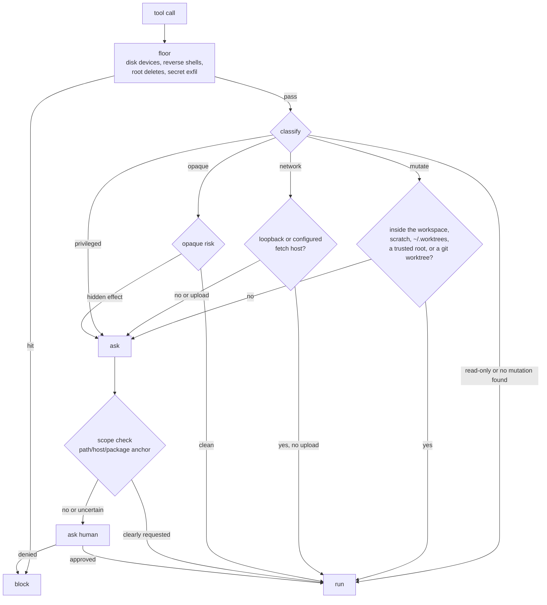

# command-guard

Guards `bash`, `write`, `edit`, and `read` with one stateless policy. An optional classifier can tighten opaque code or suppress an ask when the task clearly requests the effect. There is no approval memory and no snapshot journal: a call is allowed, asked about, or blocked from its effects and the paths and hosts it touches. Git is the recovery mechanism for code.



## Policy

| Effect                                                                                                                             | Default        |
| ---------------------------------------------------------------------------------------------------------------------------------- | -------------- |
| Read of a non-sensitive path                                                                                                       | allow          |
| Read of a credential, key, or secret                                                                                               | ask            |
| Write or edit in the workspace                                                                                                     | allow          |
| Write or edit in scratch (`/tmp`, caches, `~/.Trash`)                                                                              | allow          |
| Write or edit in a git worktree, `~/.worktrees`, or a configured `writeRoots` entry                                                | allow          |
| Write or edit in `node_modules`, `dist`, `build`, `target`, or another generated directory                                         | allow          |
| Write or edit outside those                                                                                                        | ask            |
| Delete inside the workspace, scratch, `~/.worktrees`, a git worktree, or a generated directory                                     | allow          |
| Delete outside those                                                                                                               | ask            |
| Fetch from a configured host                                                                                                       | allow          |
| Fetch from a new host                                                                                                              | ask            |
| Upload data or use a non-GET request                                                                                               | ask            |
| Local and private-network access                                                                                                   | allow          |
| `sudo`, `doas`, `su`                                                                                                               | ask every time |
| Package installs, services, cron, launchd, shell rc, git hooks                                                                     | ask            |
| `git push` (force push always), `git clean`, `git reset --hard`, `git restore`                                                     | ask            |
| Docker state changes, remote shells and transfers                                                                                  | ask            |
| Process signals                                                                                                                    | ask            |
| Disk devices, secure erase, reverse shells, `rm -rf /` or `~`, remote scripts piped to a shell, sensitive data sent to the network | block          |
| command-guard's source, its config, and `~/.pi/agent/auth.json`                                                                    | block          |

The workspace is the git root containing the session's working directory, or the working directory when it is not in a repository. A session started in the home directory or at `/` does not make that whole tree writable; writes there ask unless they land in scratch, a configured root, or a git worktree. Any path inside any git worktree is treated as recoverable. `~/.worktrees` is a default writable root because that is where this setup keeps its checkouts, and generated dependency/build directories are disposable wherever they appear.

## Config

One file, global only. A project file is not read, so a repository cannot widen its own access.

`~/.pi/agent/command-guard.json`:

```jsonc
{
	"writeRoots": ["~/.agents"], // extra writable roots; home and / are refused
	"fetchHosts": ["api.example.com"], // extends the default registry/GitHub list
	"allowGitPush": false, // ordinary pushes; force pushes still ask
	"allowPackageInstall": false, // npm/pip/brew/cargo installs
	"allowRemoteShell": false, // ssh, scp, sftp, remote rsync
	"allowReadSecrets": false, // read tool may open secrets without asking
	"classifier": {
		"model": "openrouter/liquid/d1.1",
		"timeoutMs": 5000,
		"opaqueRisk": { "ask": 0.6, "block": 0.92, "onError": "keep" },
		"scope": { "threshold": 0.65, "onError": "ask" }
	}
}
```

Unknown fields and invalid values are reported when the policy is built, never silently ignored. The file is optional; with no config the defaults in the table apply. Reload with `/reload` after editing.

Common additions:

- `"writeRoots": ["~/.agents"]` if you routinely ask the agent to create or edit skills
- `"fetchHosts": ["openrouter.ai"]` is already a default; add any private API host you use
- `"allowGitPush": true` if you want the agent to push without a prompt
- `classifier.model` is optional; without it the static policy runs alone
- `opaqueRisk.onError: "keep"` keeps the static decision when the classifier is unavailable; `"ask"` or `"block"` are stricter
- `scope.onError: "ask"` is the safe default; `"allow"` keeps suppression working offline

## Migrating from the old config

The old `profile`, `judge`, `rules`, `allowlist`, `overrides`, `limits`, and `display` keys are no longer read. Each one is reported as an unknown field and ignored; replace the file with the keys above. The behavior changes are deliberate:

- `rm -f` is no longer confirmed everywhere. Deletes inside the workspace, scratch, or a git worktree run; deletes outside ask
- `chmod` and `chown` are path-checked, not confirmed by pattern
- `shred` and `rm -P` are blocked by the floor
- the old `protect-pi-config` override is now the guard's self-protection: its config is blocked, so edit it yourself or use `/permissions yolo`

## The classifier

The classifier is optional and deliberately asymmetric. It cannot override a block or the floor.

| Check        | Runs on                                                                                                                                | Can do                                | Sees                                                                       |
| ------------ | -------------------------------------------------------------------------------------------------------------------------------------- | ------------------------------------- | -------------------------------------------------------------------------- |
| `opaqueRisk` | an `inspect` command containing an interpreter, heredoc, expansion, backtick, or eval; a mutation whose target could not be determined | tighten allow to ask, or ask to block | action, cwd, extracted targets and hosts; no user messages                 |
| `scope`      | an `ask` whose cause is on the whitelist below                                                                                         | suppress ask to allow                 | action, effect, and the user's messages; no assistant text or tool results |

Opaque risk catches effects the shell parser cannot see: a Python script that writes outside the workspace, a Node snippet that calls the network, or a hidden destructive operation. It uses four bool questions (`hiddenWrite`, `hiddenNetwork`, `persistence`, `destructive`). A repeated action is cached by content hash.

Scope suppression applies only to these causes:

- outside-workspace and pi skill writes
- new fetch hosts
- package installs
- ordinary `git push` and destructive git operations
- Docker state changes
- GitHub/API writes
- process signals
- project files that run later, such as CI workflows, hooks, editor tasks, and `.envrc`

It does not apply to privilege, system persistence, uploads, force pushes, secrets, protected paths, remote shells, or the floor. A lexical anchor is required first: the path, host, package, or operation must appear in the user's messages. “Do whatever it takes” cannot suppress an unrelated effect. The model then makes the final scope call. Scope failures ask; they never suppress.

Both checks are cached and bounded by `timeoutMs`. The turn buffer only holds the user's messages for the current run; it is not approval memory. Subagents skip scope because their task text was written by another model.

## Commands

`/permissions [default|yolo]` switches enforcement for the session. Yolo skips the entire guard, including the floor and self-protection; it is recorded in the session and only restored on `/reload`. `/guard` shows the resolved workspace, write roots, fetch hosts, classifier thresholds, protected paths, and config path.

## What is deliberately absent

- No automatic approval memory. The same input and config always produce the same decision. If a prompt repeats, add the root or host to the config rather than approving it again.
- No authorization question for reads or workspace work. The classifier only sees opaque code and asks, never ordinary exploration.
- No model result can turn a block or floor into an allow.
- No snapshot journal. Git is the recovery path for code; a path outside a repository is not called reversible. Untracked files removed by `rm` are not recoverable.
- No project config. Trusted roots and hosts come from the global file only.

## Limits

- The classifier is a parser plus a command table and an optional model, not a sandbox. Opaque interpreter bodies are reviewed by `opaqueRisk` when a model is configured, but a model can be fooled or unavailable. The floor remains authoritative.
- With `opaqueRisk.onError: "keep"`, a classifier outage falls back to the static outcome; use `"ask"` if you would rather stop on uncertainty.
- `read` is checked for sensitive paths, but `grep`, `find`, and `ls` tools are not.
- Codemode scripts are not evaluated as a unit. Nested `bash`/`write`/`edit`/`read` calls go through the guard; MCP tools, `models.classify`/`generateImages`, and other tools are outside it.
- `git status` and friends can run programs named by a repository's own config (for example `core.fsmonitor`); read-only git entries trust the repository.
- Subagents have no UI, so their ask outcomes become blocks. They can still use reads, workspace writes, and scratch.
- This is harm reduction for ordinary work, not a security boundary against a determined injected command. For that, run Pi in a container or under an OS sandbox.

## Development

```bash
npm test                              # node:test, runs TypeScript directly
node scripts/replay-sessions.ts       # replay recorded calls through the static policy
node scripts/replay-sessions.ts --samples 10
```
