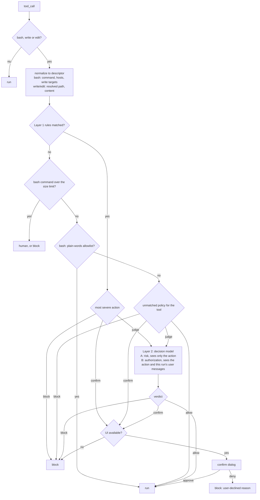

# command-guard

Guards the `bash`, `write`, and `edit` tools. A call passes through static rules, an optional strict allowlist, an optional decision model, and finally the human. With no config files the shipped rules are active under the `standard` profile.



## Config

Two optional files, merged:

- `~/.pi/agent/command-guard.json` (global)
- `.pi/command-guard.json` (project)

The project file comes from the repository you are working in, so it can only tighten the policy:

- Where the two disagree on an action, the more severe one wins
- `judge`, `allowedHosts`, `allowlist`, `limits`, and `display` are read from the global file only
- Project rules may add matchers and actions, but not text: `label`, `message`, and `denyMessage` are ignored, so a repository cannot dress up a dialog as something harmless. Its rules appear as "rule #n from the project's command-guard config"

Invalid entries are dropped and reported as warnings when the policy is first built, never silently. A rule whose matcher is malformed (`paths` that is not a list, say) is dropped whole, since keeping the rest of it would make a broader rule than the one written. Reload with `/reload` after editing.

Actions, in order of severity:

| Action    | Meaning                                                    |
| --------- | ---------------------------------------------------------- |
| `allow`   | Rule disabled                                              |
| `judge`   | Ask the decision model, which may allow, confirm, or block |
| `confirm` | Ask the human                                              |
| `block`   | Deny                                                       |

A rule with `judge` and no configured decision model degrades to `confirm`. `unmatched: judge` with no model allows instead, since it would otherwise confirm every command.

```jsonc
{
	"profile": "balanced", // standard (default) | strict | balanced | permissive
	"defaults": { "egress": "confirm" }, // per category: exfiltration egress destructive persistence obfuscation protected
	"unmatched": { "bash": "judge" }, // no rule matched and not allowlisted: per tool
	"overrides": { "egress-ip-literal": "block" }, // per rule id, beats everything else
	"allowedHosts": ["openrouter.ai"], // extends the shipped egress allowlist
	"judge": {
		"model": "typesafe/jev-latest", // <provider>/<classifier model id>
		"timeoutMs": 20000,
		"onError": "confirm", // confirm | block
		"thresholds": {
			// probabilities, per dimension; "default" is the fallback
			"default": { "confirm": 0.3, "block": 0.9 },
			"unauthorized": { "confirm": 0.5 }
		}
	},
	"allowlist": { "enabled": true }, // "commands" replaces the default list
	"limits": { "maxActionChars": 60000, "onOversize": "confirm" }, // confirm | block, see below
	"display": { "approved": "scores" }, // off (default) | scores | all, see "Approved-call notes"
	"rules": [{ "id": "no-sudo", "pattern": "\\bsudo\\b", "action": "confirm", "label": "sudo" }]
}
```

### Profiles

| Profile      | exfiltration | egress  | destructive | persistence | obfuscation | protected | unmatched bash |
| ------------ | ------------ | ------- | ----------- | ----------- | ----------- | --------- | -------------- |
| `standard`   | block        | confirm | confirm     | confirm     | confirm     | block     | allow          |
| `strict`     | block        | confirm | confirm     | confirm     | confirm     | block     | confirm        |
| `balanced`   | judge        | judge   | confirm     | judge       | judge       | block     | judge          |
| `permissive` | judge        | judge   | judge       | judge       | judge       | block     | judge          |

`defaults` and `unmatched` override the profile per key.

### Rules

A rule matches when every matcher it defines matches:

| Field     | Matches                                                                          |
| --------- | -------------------------------------------------------------------------------- |
| `pattern` | regex over the bash command (or file content, if `tools` includes write or edit) |
| `allOf`   | list of regexes that must all match                                              |
| `hosts`   | `{ tlds, domains, ipLiteral, notInAllowed }` over hosts found in the command     |
| `paths`   | regexes over write targets, in absolute and `~/` form                            |
| `tools`   | `bash`, `write`, `edit`. Default: bash, or all three for a paths-only rule       |

Other fields: `id`, `category`, `action` (fixed action, beats the category default), `label`, and for compatibility `message` (the confirm question, or the block reason handed to the model) and `denyMessage`. Text fields are honored in the global file only. Unknown fields are reported, since they are usually typos.

The shipped patterns match within one simple command: they do not pair a flag on one line with a command on another, but they do follow backslash line continuations. A flag is paired with its command across at most 1,000 characters (4,000 for the curl and wget upload flags), which keeps matching time linear in the length of the command; padding past that defeats the pairing, which is what the decision model is for.

## Decision model

The judge is a classifier model reached through `ctx.modelRegistry.classify`. Two calls run in parallel, each with a narrow view:

- Risk (A) sees the action, its working directory, and the labels of the rules that flagged it: destructive, exfiltration, persistence, and obfuscation probabilities. No conversation, so injected text elsewhere in the session cannot lower its score. Only shipped and global rule labels reach it
- Authorization (B) sees the action and the user's messages for the current run, steering included. It never sees assistant text or tool results, which is how injected instructions arrive

Answers are probabilities, not text; a non-finite or out-of-range probability counts as a failure, not as "no risk". Verdicts are cached per action, rule hints, and user messages. Failures, timeouts, and a cancelled run take the `onError` outcome, and a failure of one call cancels the other.

The judge never sees clipped text, because whatever is cut could be the dangerous part. See below for what happens to actions too large to send.

When authorization cannot be assessed, the verdict carries a note that the dialog shows. That happens when a run has no user messages, and in subagents: the `subagent` extension sets `PI_GOODIES_SUBAGENT=1` in the processes it starts, whose only "user" message is a task written by another model. Their actions still get the risk judgment.

Actions and user messages are sent to the classifier model's provider. Use a provider you would trust with your commands. A `judge.model` that the registry does not know is reported when the policy is built, rather than silently failing every judged call.

### Oversized actions

A bash command longer than `limits.maxActionChars` (default 60,000 characters, about 15,000 tokens, which fits the 65,536-token context of small classifiers with room for the user's messages) is never judged or waved through. Likewise a write or edit that would go to the judge. The outcome is `limits.onOversize`:

- `confirm` (default): the human decides, from a dialog showing the head and tail of the command and its length
- `block`: denied, with a reason telling the model to ask the user rather than split the action up

This applies ahead of the allowlist, and rules stricter than the oversize outcome keep their say. Large writes that no rule flagged are unaffected.

## The allowlist

A command takes the fast path only if it is plain words: no quotes, expansion, redirection, globbing, or composition (`; & | < > $ \` ( ) { } * ? [ \\`and so on all disqualify it). The first word must be a bare allowlisted command, flags are checked against per-command deny lists (abbreviations and bundles included), and path arguments must not be sensitive, nor, for recursive readers such as`grep`and`rg`, be an ancestor of a sensitive location. Paths are judged as written and where they really point, so a symlink in the project cannot stand in for a secret, and flags that follow symlinks (`grep -R`, `rg -L`) are refused. The allowlist only skips the decision model: it never overrides a rule match.

## Approved-call notes

Blocked and declined calls say why. A call that simply ran says nothing, so with `display.approved` set, a note appears under it in the transcript showing how it was let through:

| Level    | Calls annotated                                                                                       |
| -------- | ----------------------------------------------------------------------------------------------------- |
| `off`    | None (default)                                                                                        |
| `scores` | Calls the decision model allowed, and calls you approved after it flagged them                        |
| `all`    | Also calls that never reached the model: allowlisted, unmatched and allowed, or approved after a rule |

The note is one line, with the scores highest first so a narrow terminal cuts the least interesting ones (names are shortened, then the line is truncated). Toggling tool output expansion (the same key as for other tools) opens it into a row per dimension:

```text
$ curl https://api.example.com/v1/deploy
└ ✓ allowed by the decision model
    destructive  0.04  ━╌╌╌╌╌│╌╌╌╌╌╌╌╌╌╌╌│╌  confirm 0.30  block 0.90
    exfiltration 0.21  ━━━━╌╌│╌╌╌╌╌╌╌╌╌╌╌│╌  confirm 0.30  block 0.90
    persistence  0.01  ╌╌╌╌╌╌│╌╌╌╌╌╌╌╌╌╌╌│╌  confirm 0.30  block 0.90
    obfuscation  0.02  ╌╌╌╌╌╌│╌╌╌╌╌╌╌╌╌╌╌│╌  confirm 0.30  block 0.90
    unauthorized 0.12  ━━╌╌╌╌╌╌╌╌│╌╌╌╌╌╌╌╌╌  confirm 0.50
    flagged by   egress-unknown-host
```

- Each score is colored by its distance to the confirm threshold: muted below half, warning from half, error at or over it (which is why you were asked)
- The bar runs 0 to 1, with the confirm and block thresholds marked on it
- A dimension that was not assessed reads `n/a`, with the reason as a note (see Decision model); a model failure you approved through says `decision model unavailable`
- Notes come from the guard's decisions as they are made, and from the `command-guard` entries in the session when it is resumed. The thresholds are stored with each entry, so a note shows what applied at the time, not what the config says now. Calls that skip the model are not recorded in the session, so under `all` they get a note in the session that ran them but not after a resume

`/guard-scores [off|scores|all]` changes the level for the current session, redrawing rows already on screen; with no argument it lists the levels. The config sets the level each session starts at, and `/reload` returns to it. Nothing is shown while `/permissions yolo` is on, since nothing is decided.

## Permission modes

`/permissions [mode]` switches how the guard is enforced for the current session; with no argument it lists the modes and marks the active one. Only the human can run it, so the model cannot change the mode.

| Mode      | Effect                                                                                    |
| --------- | ----------------------------------------------------------------------------------------- |
| `default` | The configured rules, allowlist, and decision model                                       |
| `yolo`    | The guard does not run: nothing is blocked, judged, or confirmed, and nothing is recorded |

What yolo implies:

- `block` rules, the oversize outcome, and the protection of command-guard's own source and config are all bypassed. The model can therefore edit `extensions/command-guard/` or `~/.pi/agent/command-guard.json`, which loosens the guard beyond the session after the next `/reload` or new session
- The footer shows `YOLO` while it is on
- The mode is per session, never read from config or the environment. Each switch is saved as a `command-guard-mode` session entry, and only `/reload` restores it (with a notice, and only with a UI). Starting, resuming, or forking a session begins in `default`, so a session file cannot switch the guard off
- Subagents always run `default`. They have no UI, so their confirm outcomes are blocks even while the parent is in yolo

A mode is an entry in `PERMISSION_MODES` (`modes.ts`) with either `bypass: true`, or `apply`, a function from the configured policy to the policy to enforce (for example one that tightens `unmatched`). Modes that need their own refusal wording or that cover tools beyond `bash`, `write`, and `edit` would need a further seam in the pipeline.

## Limits

- Layer 1 is text matching. Obfuscated, computed, or interpreter-embedded actions are the decision model's job, and without one they are not caught
- Heredoc bodies that only feed `cat`, `tee`, or a commit or PR message are not scanned as commands, so file contents do not trigger command rules. A script written that way and run in the same command is seen only as a write target
- Hosts and write targets are extracted from wrappers (`sudo`, `timeout`, `xargs`, ...) and from `bash -c` and `eval`, a few levels deep; other indirection is not followed
- The allowed-host list governs egress, not exfiltration: GitHub and package registries accept uploads from anyone, so sending to an allowed host is not thereby safe
- Reads through the `read`, `grep`, `find`, and `ls` tools are not checked, so the sensitive-path checks cover bash reads only
- `git status` and friends can run programs named by a repository's own config (for example `core.fsmonitor`), so the allowlisted git commands trust the repository you are working in
- Only `bash`, `write`, and `edit` are covered. Other tools and MCP calls are not yet. A subagent is its own pi process running this extension, but its human-confirm outcomes are blocks (no UI) and its authorization is not assessed

## Development

```bash
npm test                              # node:test, runs TypeScript directly
node scripts/replay-sessions.ts       # replay recorded tool calls through Layer 1 and report rule hits
node scripts/explain-matches.ts <id>  # show what a rule's pattern matched in recorded commands
```
